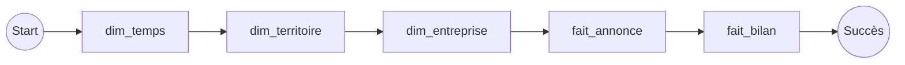
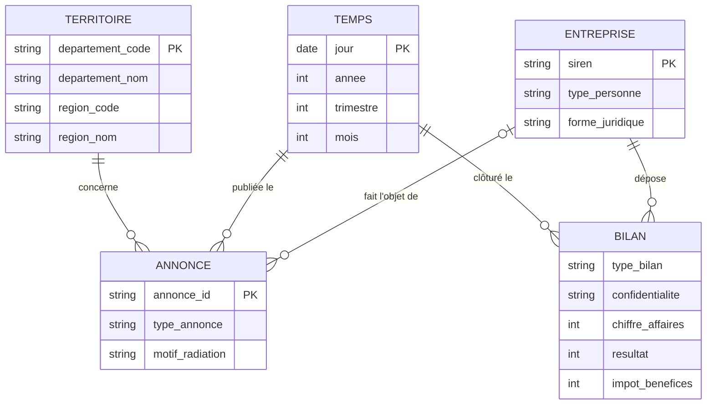
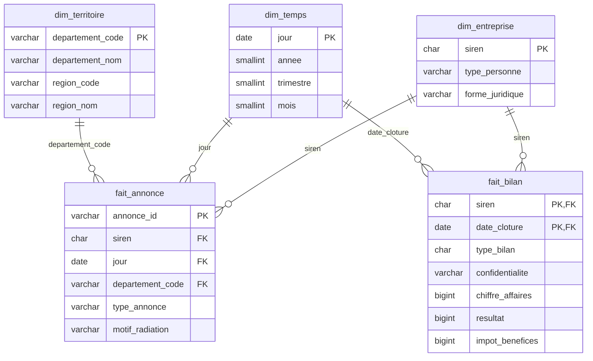

# Exercice 2 : traitements Apache Hop, du data lake au data warehouse

Objectif : transformer les fichiers bruts du data lake (bucket S3) en tables prêtes à être insérées dans le data warehouse, sans écrire de code, avec Apache Hop.

## 1. Apache Hop en bref

Apache Hop est un ETL open source « no code » : les traitements se construisent graphiquement dans **Hop GUI**, en reliant des briques entre elles.

| Notion | Rôle |
|---|---|
| **Pipeline** (`.hpl`) | Traitement de données. Une suite de *transforms* reliées par des *hops* ; les lignes circulent en flux et toutes les transforms tournent en parallèle. |
| **Transform** | Une opération unitaire : lire un fichier, filtrer, renommer, calculer, dédoublonner, écrire dans une table… |
| **Workflow** (`.hwf`) | Orchestration. Enchaîne des *actions* dans l'ordre (lancer un pipeline, tester une condition, envoyer une alerte). |
| **Metadata** | Objets réutilisables : connexion PostgreSQL, connexion S3/MinIO, configuration d'exécution. |
| **Projet / environnement** | Regroupe pipelines, workflows et metadata ; les variables (`${BUCKET}`, mots de passe…) changent selon l'environnement (dev, prod). |

Exécution : dans Hop GUI pendant la conception, puis en ligne de commande avec `hop-run` (ou depuis un orchestrateur comme Airflow, cf. exercice 3).

## 2. Le flux de traitement

### Données d'entrée (data lake)

| Fichier dans le bucket | Contenu |
|---|---|
| `raw/bodacc/<année>.parquet` | Annonces BODACC de création et de radiation, un fichier par année depuis 2008 ; la colonne `familleavis` vaut `creation` ou `radiation` (11 M au total) |
| `raw/inpi/donnees_financieres.parquet` | Bilans déposés, liasse fiscale en colonne `liasse` (code → montant) (6,4 M) |

Hop lit le bucket grâce à une connexion **MinIO** (compatible S3) déclarée dans les metadata, et écrit dans le data warehouse grâce à une connexion **PostgreSQL**.

### Orchestration : workflow `chargement_dw.hwf`

Les dimensions sont chargées avant les faits, pour que les clés étrangères existent au moment de l'insertion.

### Les pipelines

**1. `dim_temps`** : un jour par ligne, de 2000 à 2030.
`Generate rows` (11 323 lignes) → `Add sequence` (n° du jour) → `Calculator` (date de départ + n jours, année, trimestre, mois) → `Table output`.

**2. `dim_territoire`** : la liste des départements.
`Get file names` (`raw/bodacc/*.parquet`) → `Parquet File Input` → `Select values` (code et nom du département, code et nom de la région) → `Unique rows (HashSet)` sur le code → `Filter rows` (code non vide) → `Table output`.

**3. `dim_entreprise`** : une ligne par SIREN.
`Get file names` (`raw/bodacc/*.parquet`) → `Parquet File Input` → `Filter rows` (`typeavis = annonce`) → nettoyage du SIREN (voir ci-dessous) → `Regex evaluation` sur `listepersonnes` (extrait `typePersonne` et `formeJuridique`) → `String operations` (minuscules, espaces) → `Append streams` avec les SIREN des bilans → `Unique rows (HashSet)` sur le SIREN → `Table output`.

**4. `fait_annonce`** : une ligne par annonce.
`Get file names` (`raw/bodacc/*.parquet`) → `Parquet File Input` → `Filter rows` (`typeavis = annonce`) → nettoyage du SIREN → `Switch / case` sur `radiationaurcs`, en mode « contient », pour les radiations (*Radiation d'office* → `office`, *liquidation* → `liquidation`, sinon `autre`) → `Select values` (renommage : `id` → `annonce_id`, `familleavis` → `type_annonce`, `dateparution` → `jour`, `numerodepartement` → `departement_code`) → `Table output`.

**5. `fait_bilan`** : un bilan par entreprise et par exercice.
`Table input` sur une connexion **DuckDB**, qui lit le Parquet dans le bucket et extrait les codes utiles de la colonne `liasse` → `Filter rows` (comptes sociaux `C` ou `S` uniquement, clôture entre 2000 et 2030) → `Sort rows` (SIREN, date de clôture, type) → `Unique rows` (SIREN, date de clôture) → `Calculator` (chiffre d'affaires du régime simplifié) → `Table output`.

C'est le seul pipeline où une requête est écrite, parce que `liasse` est une colonne de type *map* (code → montant) : DuckDB y accède directement par le code (`liasse['HK']`).

### Règles de transformation

| Règle | Pourquoi |
|---|---|
| Seuls les avis initiaux sont gardés (`typeavis = annonce`) | Les annulations et rectificatifs compteraient deux fois la même annonce. |
| SIREN = 1ʳᵉ partie de `registre`, sans espaces | `registre` vaut `"449 850 908,449850908"` ou l'inverse selon l'annonce. |
| `type_personne` : `pm` (société) ou `pp` (entrepreneur individuel) | Seules les sociétés paient l'IS. |
| Motif de radiation : `office`, `liquidation`, `autre` | Les radiations d'office sont administratives ; elles faussent le nombre de fermetures (cf. exercice 1). |
| Bilans : comptes consolidés (`K`) écartés, un bilan par SIREN et par exercice, complet (`C`) prioritaire sur simplifié (`S`) | Éviter de compter deux fois la même entreprise. |
| Codes de la liasse | Régime normal : `FL` = chiffre d'affaires, `HN` = résultat, `HK` = impôt sur les bénéfices. Régime simplifié : `210 + 214 + 218` = chiffre d'affaires, `310` = résultat, `306` = impôt. |
| Impôt absent mais résultat présent → impôt = 0 | Une ligne vide de la liasse vaut zéro. |

## 3. Modèle du data warehouse

Schéma en étoile : deux tables de faits (annonces, bilans) qui partagent les dimensions.

### MCD

Environ 0,8 % des annonces n'ont pas de SIREN, d'où la cardinalité 0..1 entre annonce et entreprise.

### MLD

Volumes attendus : environ 9,4 M annonces et 6,3 M bilans.
