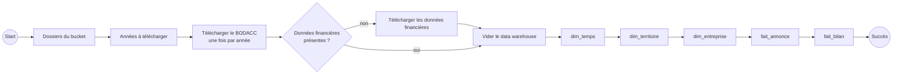
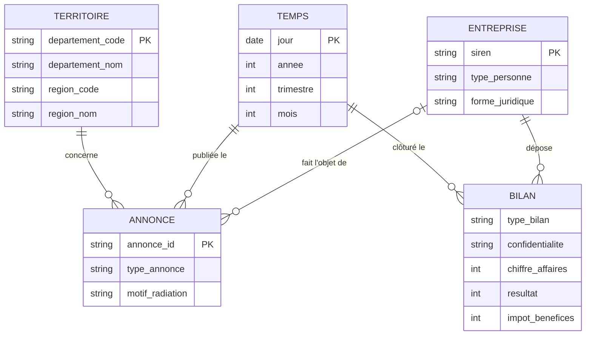
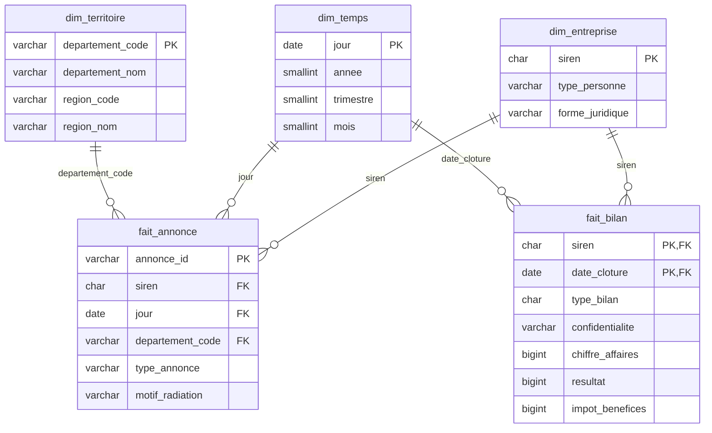

# Exercice 2 : traitements Apache Hop, du data lake au data warehouse

Objectif : transformer les fichiers bruts du data lake (bucket S3) en tables du data warehouse, sans écrire de code, avec Apache Hop.

## Lancer

Prérequis : Docker et une connexion internet.

```bash
cd exercice-2
docker compose up --build
```

Le service `hop` exécute le workflow `hop/chargement_dw.hwf` puis s'arrête. Le relancer : `docker compose run --rm hop`. Compter environ 50 minutes (Hop traite les 17 M de lignes une à une), plus 30 à 40 minutes si les données brutes sont à télécharger.

| Service | Rôle | Accès |
|---|---|---|
| `datalake` | Data lake S3 ([RustFS](https://rustfs.com)) | console http://localhost:9001 (`admin` / `admin12345`) |
| `dw` | Data warehouse PostgreSQL, schéma créé par `sql/01_dw.sql` | `localhost:5433` (`dw` / `dw`) |
| `hop` | Apache Hop 2.19 en ligne de commande (`hop-run`), plus le pilote JDBC DuckDB | |

Le data lake utilise le même volume Docker que l'exercice 3 (`speak-with-data_datalake`) : les données brutes ne sont téléchargées qu'une fois, par le premier exercice lancé. Les deux exercices ne tournent pas en même temps (mêmes ports).

Pour un test rapide sur une seule année, mettre `2009\.parquet` dans la variable `BODACC_FICHIERS` de `hop/project-config.json`.

## 1. Apache Hop en bref

Apache Hop est un ETL open source « no code » : les traitements se construisent graphiquement dans **Hop GUI**, en reliant des briques entre elles. Les fichiers produits (XML) s'ouvrent dans Hop GUI et s'exécutent en ligne de commande avec `hop-run`.

| Notion | Rôle |
|---|---|
| **Pipeline** (`.hpl`) | Traitement de données. Une suite de *transforms* reliées par des *hops* ; les lignes circulent en flux et toutes les transforms tournent en parallèle. |
| **Transform** | Une opération unitaire : lire un fichier, filtrer, renommer, calculer, dédoublonner, écrire dans une table… |
| **Workflow** (`.hwf`) | Orchestration. Enchaîne des *actions* dans l'ordre (lancer un pipeline, télécharger un fichier, tester une condition), avec un chemin en cas de succès et un en cas d'échec. |
| **Metadata** | Objets réutilisables : connexions aux bases, au stockage S3, configurations d'exécution. |
| **Projet / variables** | Regroupe pipelines, workflows et metadata ; les accès (`${S3_HOST}`, `${PGPASSWORD}`…) sont des variables, fournies ici par le `docker-compose.yml`. |

Connexions déclarées dans `hop/metadata/` :

| Connexion | Type Hop | Rôle |
|---|---|---|
| `lake` | MinIO | Le data lake. Hop n'a pas de connecteur RustFS : son connecteur MinIO parle le protocole S3, que RustFS respecte. Chemins de la forme `lake://datalake/raw/...` |
| `dw` | PostgreSQL | Le data warehouse |
| `duckdb` | DuckDB (en mémoire) | Lecture de la liasse fiscale des bilans (voir `fait_bilan`) et comptage des lignes d'un Parquet téléchargé |

## 2. Le flux de traitement

### Données brutes (data lake)

| Fichier dans le bucket | Contenu | Source |
|---|---|---|
| `raw/bodacc/<année>.parquet` | Annonces BODACC de création et de radiation, un fichier par année depuis 2008 ; `familleavis` vaut `creation` ou `radiation` (11 M au total) | [API du BODACC](https://bodacc-datadila.opendatasoft.com/explore/dataset/annonces-commerciales/) |
| `raw/inpi/donnees_financieres.parquet` | Bilans déposés, liasse fiscale en colonne `liasse` (code → montant) (6,4 M) | [data.gouv.fr](https://www.data.gouv.fr/datasets/donnees-financieres-detaillees-des-entreprises-format-parquet) |

### Orchestration : workflow `chargement_dw.hwf`



**Téléchargement.** Le site du BODACC coupe sans prévenir les gros exports : on télécharge donc année par année.
- `annees_a_telecharger` liste les années de 2008 à aujourd'hui, garde celles absentes du bucket, plus l'année en cours (elle change tous les jours).
- `telecharger_bodacc.hwf` est exécuté une fois par année retenue : action `HTTP` vers `/tmp`, puis `verifier_bodacc` (le fichier doit être lisible et avoir le nombre de lignes annoncé par l'API, sinon `Abort`), puis `Copy files` vers le bucket. Trois essais, à 30 s d'intervalle.
- `telecharger_inpi.hwf`, seulement si le fichier manque : `url_inpi` lit sur data.gouv.fr l'adresse de la dernière version, puis même schéma téléchargement → vérification → dépôt.
- Les actions `Create folder` créent les dossiers du bucket : sans eux, le connecteur MinIO de Hop ne voit pas les fichiers d'un dossier S3.

**Chargement.** Le data warehouse est vidé puis rechargé : le workflow peut être relancé sans doublons. Les dimensions sont chargées avant les faits, pour que les clés étrangères existent au moment de l'insertion.

### Les pipelines de chargement

**1. `dim_temps`** : un jour par ligne, de 2000 à 2030.
`Generate rows` (11 323 lignes) → `Add sequence` (n° du jour) → `Calculator` (date de départ + n jours, année, trimestre, mois) → `Select values` → `Table output`.

**2. `dim_territoire`** : la liste des départements.
`Get file names` (`raw/bodacc/`) → `Parquet File Input` → `Filter rows` (département renseigné) → `Unique rows (HashSet)` sur le code → `Select values` (renommage, code région en texte) → `Table output`.

**3. `dim_entreprise`** : une ligne par SIREN.
`Get file names` → `Parquet File Input` → `Filter rows` (`typeavis = annonce`) → nettoyage du SIREN (`Replace in string` : espaces supprimés, puis `Regex evaluation` : 9 chiffres) → `Filter rows` (SIREN trouvé) → `Regex evaluation` sur `listepersonnes` (`typePersonne`, puis `formeJuridique`) → `String operations` (minuscules) → `Append streams` avec les SIREN des bilans (`Table input` DuckDB) → `Sort rows` (SIREN, annonce la plus récente d'abord) → `Unique rows` sur le SIREN → `Table output`.

**4. `fait_annonce`** : une ligne par annonce.
`Get file names` → `Parquet File Input` → `Filter rows` (`typeavis = annonce`) → nettoyage du SIREN → `Switch / case` sur `familleavis` → pour les radiations, `String operations` (minuscules) puis `Switch / case` sur `radiationaurcs` en mode « contient » (*radiation d'office* → `office`, *liquidation* → `liquidation`, sinon `autre`), via des `Add constants` → `Select values` (renommage : `id` → `annonce_id`, `familleavis` → `type_annonce`, `dateparution` → `jour`, `numerodepartement` → `departement_code`) → `Table output`.

**5. `fait_bilan`** : un bilan par entreprise et par exercice.
`Table input` (DuckDB : codes utiles de la colonne `liasse`) → `Filter rows` (comptes sociaux `C` ou `S`, clôture entre 2000 et 2030, SIREN de 9 chiffres) → `Sort rows` (SIREN, date de clôture, type) → `Unique rows` (SIREN, date de clôture : `C` passe avant `S`) → `Switch / case` sur le type :
régime normal → `Calculator` (CA = `FL`, résultat = `HN`, impôt = `HK`) ;
régime simplifié → `If field value is null` (lignes vides à 0) → `Calculator` (CA = `210 + 214 + 218`, résultat = `310`, impôt = `306`) → `Null if` (CA nul = non publié)
→ `Filter rows` (résultat publié) → `If field value is null` (impôt vide = 0) → `Table output`.

Les deux seules requêtes écrites sont dans des `Table input` DuckDB, parce que `liasse` est une colonne de type *map* (code → montant) que les transforms Parquet de Hop ne savent pas lire : DuckDB y accède directement par le code (`liasse['HK']`).

### Règles de transformation

| Règle | Pourquoi |
|---|---|
| Seuls les avis initiaux sont gardés (`typeavis = annonce`) | Les annulations et rectificatifs compteraient deux fois la même annonce. |
| SIREN = 1ʳᵉ partie de `registre`, sans espaces, 9 chiffres | `registre` vaut `"449 850 908,449850908"` ou l'inverse selon l'annonce. |
| `type_personne` : `pm` (société) ou `pp` (entrepreneur individuel) ; forme juridique en minuscules | Seules les sociétés paient l'IS. |
| Motif de radiation : `office`, `liquidation`, `autre`, sans tenir compte des majuscules | Les radiations d'office sont administratives ; elles faussent le nombre de fermetures (cf. exercice 1). |
| Bilans : comptes consolidés (`K`) écartés, un bilan par SIREN et par exercice, complet (`C`) prioritaire sur simplifié (`S`) | Éviter de compter deux fois la même entreprise. |
| Codes de la liasse | Régime normal : `FL` = chiffre d'affaires, `HN` = résultat, `HK` = impôt sur les bénéfices. Régime simplifié : `210 + 214 + 218` = chiffre d'affaires, `310` = résultat, `306` = impôt. |
| Impôt absent mais résultat présent → impôt = 0 | Une ligne vide de la liasse vaut zéro. |

## 3. Modèle du data warehouse

Schéma en étoile : deux tables de faits (annonces, bilans) qui partagent les dimensions.

### MCD



Environ 1,5 % des annonces n'ont pas de SIREN, d'où la cardinalité 0..1 entre annonce et entreprise.

### MLD

Créé au premier démarrage de PostgreSQL par `sql/01_dw.sql`.



Volumes : environ 10,9 M annonces et 6,3 M bilans.
