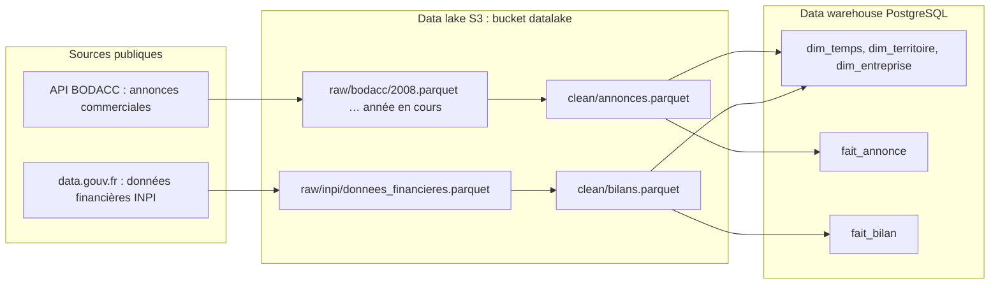
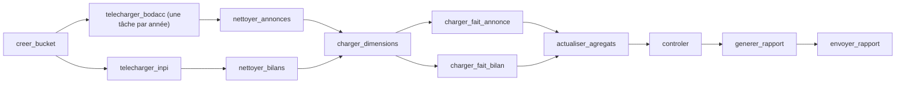
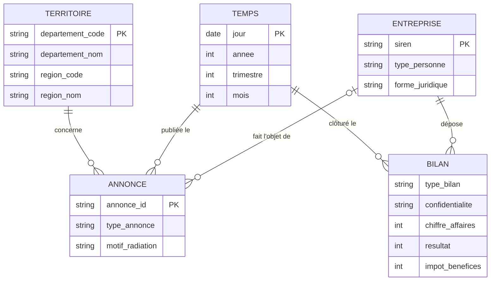
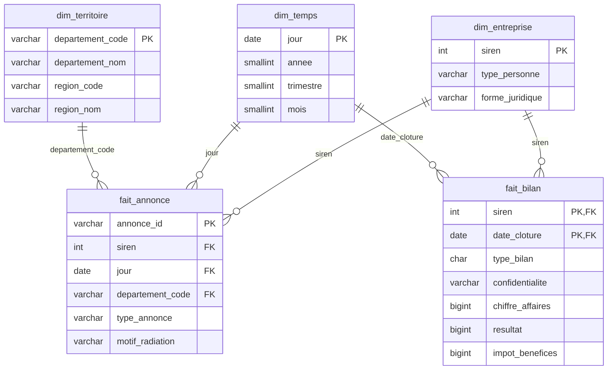

# Exercice 3 : data lake, Airflow et data warehouse en Docker

Un `docker compose up` monte toute la chaîne : un DAG Airflow télécharge les données publiques dans un bucket S3, les nettoie puis les charge dans un data warehouse PostgreSQL, et un Jupyter permet d'explorer les deux.

## Lancer

Prérequis : Docker et une connexion internet. Les données ne sont pas versionnées, le DAG les télécharge lui-même.

```bash
cd exercice-3
docker compose up -d --build
```

Le DAG `chargement_dw` est hebdomadaire : il se lance seul au premier démarrage, puis chaque semaine. Pour le relancer à la main : Airflow sur http://localhost:8080, bouton **Trigger**, ou en ligne de commande :

```bash
docker compose exec airflow airflow dags trigger chargement_dw
```

Le premier lancement prend environ 40 minutes, dont 30 pour télécharger les 5 Go de données ; les suivants ne retéléchargent que l'année en cours. `docker compose down` arrête tout ; `docker compose down -v` efface aussi le bucket et la base, qui seront à retélécharger.

| Service | Rôle | Accès |
|---|---|---|
| `datalake` | Data lake S3 ([RustFS](https://rustfs.com), compatible MinIO/AWS) | API `localhost:9000`, console http://localhost:9001 (`admin` / `admin12345`) |
| `dw` | Data warehouse PostgreSQL (base `dw`) et métadonnées Airflow (base `airflow`) | `localhost:5433` (`dw` / `dw`) |
| `airflow` | Orchestration et visualisation des flux | http://localhost:8080 |
| `jupyter` | Prototypage Python (`notebooks/exploration.ipynb`) | http://localhost:8888 |
| `web` | Reporting web : les graphiques du notebook | http://localhost:8000 |
| `mail` | Boîte mail de test ([Mailpit](https://mailpit.axllent.org)) : reçoit le rapport hebdomadaire | http://localhost:8025 |

Les ports n'écoutent que sur `127.0.0.1` : les services, sans mot de passe pour Airflow et Jupyter, ne sont pas accessibles depuis le réseau.

Airflow, Jupyter et le site partagent la même image (`Dockerfile`) : Airflow 3.3, DuckDB, JupyterLab et Plotly. DuckDB lit et écrit directement dans le bucket et dans PostgreSQL : pas de fichier intermédiaire en local.

MinIO a été remplacé par RustFS parce que les images MinIO ne sont plus publiées sur Docker Hub. Le protocole S3 est le même.

## Reporting web

Les graphiques validés dans le notebook sont publiés sur http://localhost:8000.

- **Même code** : chaque graphique est une fonction de `reporting/graphiques.py`, qui renvoie une figure Plotly. Le notebook l'affiche (`societes_par_annee()`), le site l'intègre en HTML (`reporting/web.py`) : les graphiques sont strictement identiques.
- **Microframework** : FastAPI, servi par uvicorn. Les deux sont déjà fournis par l'image Airflow 3 : la seule dépendance ajoutée est Plotly, qui fournit aussi Plotly.js (copie locale, aucun CDN). Les courbes utilisent le rendu WebGL de Plotly (`Scattergl`).
- **Données** : les graphiques lisent les agrégats `kpi_annonces` et `kpi_bilans` (quelques millisecondes), recalculés à chaque chargement : le site est à jour dès la fin du DAG.

## Rapport

À la fin de chaque chargement, le DAG produit un rapport PDF d'une page et l'envoie par email : chaque semaine, les destinataires reçoivent les indicateurs à jour sans rien demander.

- **Contenu** : quatre chiffres clés et les graphiques du notebook, produits par le même code (`reporting/graphiques.py`) que le notebook et le site web.
- **Édition** : un modèle HTML/CSS ([Jinja2](https://jinja.palletsprojects.com), fourni par Airflow) remplit `reporting/rapport.html` ; Chromium sans fenêtre l'imprime en PDF (`reporting/rapport.py`). Plotly.js dessine les graphiques dans la page : ils restent vectoriels dans le PDF.
- **Diffusion** : PDF archivé dans le data lake, puis envoyé par SMTP. En démonstration, le serveur est Mailpit, qui garde les messages sans les envoyer : le rapport se lit sur http://localhost:8025. En production, il suffit de pointer `SMTP_HOST` vers un vrai serveur.

## Les flux



### DAG Airflow `chargement_dw`



| Tâche | Ce qu'elle fait |
|---|---|
| `creer_bucket` | Crée le bucket `datalake` s'il n'existe pas. |
| `telecharger_bodacc` | Une tâche par année depuis 2008, 4 en parallèle : exporte les créations et radiations de l'année depuis l'API du BODACC vers `raw/bodacc/<année>.parquet`. Le site coupe sans prévenir les gros exports, d'où le découpage : chaque fichier doit être lisible et avoir le nombre de lignes annoncé par l'API, sinon Airflow relance l'année. Les années passées déjà présentes ne sont pas retéléchargées ; l'année en cours l'est à chaque lancement. |
| `telecharger_inpi` | Récupère sur data.gouv.fr l'adresse de la dernière version du fichier et le dépose dans `raw/inpi/`, s'il n'y est pas déjà. |
| `nettoyer_annonces` | Lit toutes les années, garde les avis initiaux, extrait le SIREN, le type de personne et la forme juridique, classe le motif de radiation. Écrit `clean/annonces.parquet`. |
| `nettoyer_bilans` | Garde les comptes sociaux, un bilan par SIREN et par exercice, extrait CA, résultat et impôt de la liasse fiscale. Écrit `clean/bilans.parquet`. |
| `charger_dimensions` | Vide le data warehouse puis charge les 3 dimensions. Le DAG peut donc être relancé sans doublons. |
| `charger_fait_annonce`, `charger_fait_bilan` | Chargent les faits, en parallèle. |
| `actualiser_agregats` | Recalcule les vues d'agrégats (`kpi_annonces`, `kpi_bilans`) et met à jour les statistiques de PostgreSQL (`ANALYZE`). |
| `controler` | Échoue si une table est vide ; affiche le nombre de lignes et l'indicateur de l'exercice 1 (sociétés créées / radiées hors radiations d'office, par année). |
| `generer_rapport` | Produit le rapport PDF (voir Rapport) et l'archive dans le bucket, `reports/rapport-<date>.pdf`. |
| `envoyer_rapport` | Envoie le rapport en pièce jointe aux destinataires de `RAPPORT_DESTINATAIRES` (serveur SMTP `mail`). |

### Règles de nettoyage

| Règle | Pourquoi |
|---|---|
| Seuls les avis initiaux (`typeavis = annonce`) | Les annulations et rectificatifs compteraient deux fois la même annonce. |
| SIREN = 1ʳᵉ partie de `registre`, sans espaces, 9 chiffres | `registre` vaut `"449 850 908,449850908"` ou l'inverse selon l'annonce. |
| `type_personne` : `pm` (société) ou `pp` (entrepreneur individuel) | Seules les sociétés paient l'IS. |
| Motif de radiation : `office`, `liquidation`, `autre` | Les radiations d'office sont administratives et faussent le nombre de fermetures. |
| Bilans : comptes consolidés écartés, un bilan par SIREN et par exercice (complet prioritaire sur simplifié), clôture entre 2000 et 2030 | Ne pas compter deux fois la même entreprise ; écarter les dates aberrantes (1919, 2029…). |
| Liasse : `FL` / `HN` / `HK` (régime normal), `210+214+218` / `310` / `306` (simplifié) | Codes du chiffre d'affaires, du résultat et de l'impôt sur les bénéfices. |
| Résultat publié mais impôt absent → impôt = 0 | Une ligne vide de la liasse vaut zéro. |

## Forme finale des données

**Deux étapes de stockage.** `raw/` garde les fichiers tels que téléchargés : on peut toujours tout recalculer. `clean/` contient les données nettoyées, au format du data warehouse, en Parquet : on les relit dans Jupyter sans toucher à la base, et le chargement ne refait pas le nettoyage.

**Un schéma en étoile dans le data warehouse.** Les questions de l'exercice 1 se posent toutes de la même façon : *combien* (annonces, impôt, chiffre d'affaires) *par* année, département, type d'entreprise. Les faits portent ce qu'on compte ou additionne, les dimensions ce par quoi on découpe :

- **deux faits**, parce qu'ils n'ont pas le même grain : une annonce est un événement daté, un bilan est un exercice comptable ;
- **trois dimensions partagées** : le SIREN relie annonces et bilans (survie, impôt des sociétés créées) ; la date et le département permettent de comparer avant et après une réforme, et territoire par territoire ;
- les noms des personnes ne sont pas repris : ils ne servent à aucun indicateur.

### MCD



### MLD

Créé au premier démarrage de PostgreSQL par `sql/01_dw.sql`.



Deux vues matérialisées d'agrégats complètent le modèle (voir Optimisation) :

| Vue | Grain | Contenu |
|---|---|---|
| `kpi_annonces` | année × type d'annonce × motif × type de personne × département | nombre d'annonces |
| `kpi_bilans` | année × tranche de chiffre d'affaires | entreprises, entreprises qui paient l'IS, IS total |

## Optimisation

Optimiser une base, c'est réduire ce qu'elle lit et stocke pour répondre aux questions qu'on lui pose réellement.

**En volume :**
- des types au plus juste : entier plutôt que texte pour un code numérique, `smallint` pour une année, pas de `varchar` surdimensionné ;
- des valeurs répétées factorisées dans une dimension (une forme juridique stockée une fois, référencée par un petit entier) ;
- seulement les index utiles, et du bon type : un index BRIN pour une colonne rangée dans l'ordre physique (dates d'insertion) pèse quelques Ko au lieu de dizaines de Mo ;
- le partitionnement (par année) pour archiver ou purger un bloc entier sans réécrire la table.

**En temps de requête :**
- pré-calculer les agrégats qu'on interroge sans cesse (vues matérialisées, tables d'agrégats), recalculés au chargement plutôt qu'à chaque lecture ;
- des index sur les colonnes de filtre et de jointure, et des statistiques à jour (`ANALYZE`) pour que le planificateur choisisse le bon plan ;
- des jointures sur des clés entières, plus rapides à comparer que du texte ;
- au chargement, insérer en masse (`COPY`), dans l'ordre utile (date), puis construire les index.

**Appliqué ici** (commit dédié, `sql/01_dw.sql` et le DAG) :

| Changement | Effet |
|---|---|
| SIREN en `integer` au lieu de `char(9)` dans les 3 tables | 4 octets au lieu de 10, dans les tables et les 3 index qui le contiennent |
| Index BRIN sur `fait_annonce.jour`, annonces insérées par date | remplace un B-tree de 85 Mo |
| Vues matérialisées `kpi_annonces` et `kpi_bilans`, lues par le notebook | les indicateurs ne joignent plus 10,9 M d'annonces à 9,2 M d'entreprises |
| `ANALYZE` après chaque chargement | statistiques justes dès la fin du DAG |

**Mesures** (même machine, cache chaud, avant et après ce commit) :

| | Avant | Après |
|---|---|---|
| Taille de la base | 3 354 Mo | 2 909 Mo (−13 %) |
| `dim_entreprise` + index | 585 + 356 Mo | 525 + 263 Mo |
| `fait_bilan` + clé primaire | 496 + 221 Mo | 447 + 157 Mo |
| Index `fait_annonce(siren)` | 381 Mo | 283 Mo |
| Index `fait_annonce(jour)` | 85 Mo (B-tree) | 24 Ko (BRIN) |
| Q1 : sociétés créées et radiées par année | 12 à 18 s | 4,5 s sur les faits, 3 ms dans `kpi_annonces` |
| Q2 : IS 2023 par tranche de CA | 0,8 s | 0,4 s sur les faits, 0,2 ms dans `kpi_bilans` |
| Q3 : annonces d'un SIREN | 4,6 ms | 0,2 ms |
| Q4 : annonces d'un mois | 116 ms | 12 ms |

La table `fait_annonce` ne rétrécit presque pas : chaque ligne est alignée sur 8 octets, les 6 octets gagnés sur le SIREN se perdent dans l'alignement. Pour aller plus loin, il faudrait factoriser `type_annonce` et `motif_radiation` (codes sur 1 octet) et la forme juridique (dimension à part).

Mesurer : `docker compose exec -T dw psql -U dw -d dw < mesures.sql` (tailles des tables et index, durée des requêtes de référence).
